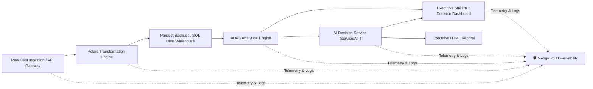

# ADAS - Automated Data Analytical System & Executive Decision Hub

ADAS is an end-to-end enterprise data engineering and analytical platform that transforms raw transactional sales data into strategic executive decisions.

---

## 🏗️ Architecture Overview



1. **Ingestion & Ingestion API**: FastAPI endpoint serving compressed sales transaction records with automatic latency middleware.
2. **Transformation Engine (`pipeline/transformer/main.py`)**: Polars-based schema validation, deduplication, imputation, and temporal feature enrichment.
3. **Analytical Engine (`engines/analytical_engine.py`)**: High-performance vectorized calculation of business KPIs, Pareto (ABC) product classification, customer RFM cohorts, What-If pricing elasticity simulation, inventory run-rate velocity, and prescriptive action recommendations.
4. **AI Decision Service (`services/AI_` / `service/AI_`)**: Natural-language conversational copilot answering questions in Streamlit chat, detecting analytical intent, and generating self-contained print-ready HTML executive reports.
5. **Mahgaurd Observability & Logging (`mahgaurd/`)**: Project-wide centralized rotating file logger (`mahgaurd/logs/adas.log`), function latency telemetry (`@timed`), and real-time subsystem health diagnostics.
6. **Decision Management System (`DecisionManager`)**: Persistent log recording business questions, executive decision answers, rationale, projected financial impact, and status audit trails.
7. **Interactive Executive Dashboard (`frontend/streamlit/app.py` / `app.py`)**: Modern executive UI featuring interactive Plotly visualizations, live AI Chat, and an integrated Mahgaurd observability portal.

---

## 🚀 Quickstart: Running the Streamlit Dashboard

To launch the dashboard locally:

```powershell
# Activate your virtual environment
.\.venv\Scripts\Activate.ps1

# Launch the Streamlit dashboard
streamlit run app.py
```

Or run via Python module:
```powershell
python -m streamlit run frontend/streamlit/app.py
```

### 🐳 Running via Docker Compose (Recommended for Containerized Deployment)

Run all services together (FastAPI Gateway, Airflow Pipeline, and Streamlit Dashboard):

```powershell
# Build and launch all containers
docker compose up -d --build

# Or start only the Streamlit frontend service:
docker compose up -d --build frontend
```

Service endpoints:
- **Streamlit Analytics Dashboard**: [http://localhost:8501](http://localhost:8501)
- **FastAPI Ingestion Gateway**: [http://localhost:8000/docs](http://localhost:8000/docs)
- **Apache Airflow Pipeline UI**: [http://localhost:8080](http://localhost:8080)

---

## 📊 Dashboard Modules & Decision Views

| View | Purpose | Key Executive Decisions Enabled |
| :--- | :--- | :--- |
| **Executive Overview** | Global revenue, volume, AOV, MoM growth, moving averages, and prescriptive alert cards. | High-level performance tracking, channel prioritization. |
| **Product & Pareto (80/20)** | ABC item classification (Class A: top 80% revenue, Class B: next 15%, Class C: bottom 5%). | SKU rationalization, catalog pricing, and supply chain priority. |
| **Customer RFM Cohorts** | Recency, Frequency, Monetary customer segmentation (Champions, At-Risk, Loyalists). | Targeted re-engagement and retention budget allocation. |
| **What-If Simulator** | Interactive price change, discount reduction, and price elasticity modeling. | Test pricing policies and gross margin impact before committing. |
| **Inventory & Stockout Risk** | Depletion run-rate, days of inventory, safety stock alerts, and reorder amounts. | Prevent stockouts, optimize working capital. |
| **Strategic Decision Hub** | Form to log concrete business decisions, answers, rationale, assigned owner, and status. | Official executive decision audit trail with CSV export. |
| **🤖 AI Assistant & Chat** | Natural language queries, revenue breakdown, SKU discovery, stockout check, and HTML report generator. | Instant conversational executive decision intelligence. |
| **🛡️ Mahgaurd Observability** | Real-time system health, telemetry latencies, and streaming project log viewer. | Project-wide transparency, diagnostic monitoring, and auditability. |

---

## 🤖 Free LLM Integration (Google Gemini, Groq, OpenRouter)

ADAS AI provides native support for free cloud LLMs with zero credit card required:

| Free Provider | Model | Free Tier Limits | Get Free Key |
| :--- | :--- | :--- | :--- |
| **Google Gemini** | `gemini-1.5-flash` | 15 req/min, 1,500 req/day (Free forever) | [Google AI Studio](https://aistudio.google.com/app/apikey) |
| **Groq Cloud** | `llama-3.3-70b-versatile` | 30 req/min, Ultra-fast sub-second latency | [Groq Cloud Console](https://console.groq.com/keys) |
| **OpenRouter** | `meta-llama/llama-3.3-70b-instruct:free` | Free open-source routing | [OpenRouter Keys](https://openrouter.ai/keys) |

### How to use:
1. **Via Streamlit Dashboard**: Open Tab 7 (*🤖 AI Assistant & Chat*), expand the **"🔑 Free LLM API Key Settings"** panel, paste your key, and click **"💾 Apply Key"**.
2. **Via `.env` file**: Add `GEMINI_API_KEY="AIza..."` or `GROQ_API_KEY="gsk_..."` to `frontend/.env`.
3. **Autonomous Fallback**: If no API key is provided, the AI Assistant automatically falls back to its built-in local deterministic analytical intelligence without crashing.

---

## 🧪 Testing the Analytical & AI Engines

Test the AI Service and Mahgaurd subsystem directly from your terminal:

```powershell
# Test Analytical Engine
python -m engines.analytical_engine

# Test AI Service & Report Generator
python -c "import services.AI_ as ai; s = ai.get_ai_service(); print(s.ask('What is our revenue?')['answer']); print('Report:', s.ask('Generate report')['report_path'])"
```


